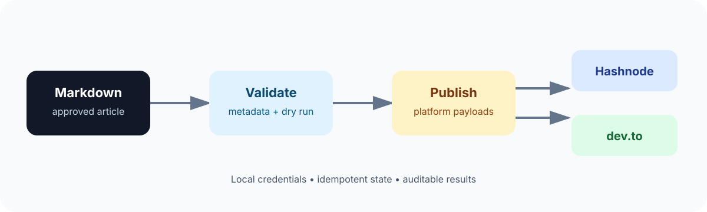
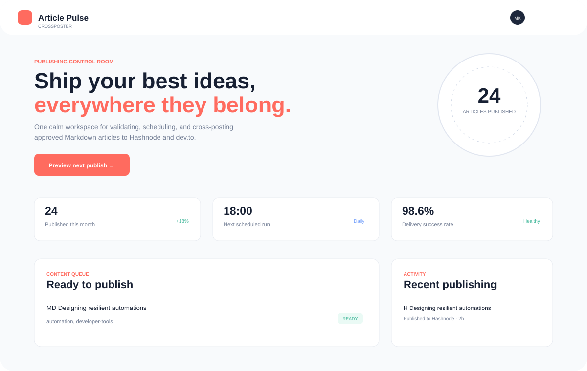

# Article Pulse Crossposter


Automate approved Markdown article publishing to **Hashnode** and **dev.to** from one local, reproducible content workflow.



## Product preview

The repository includes a lightweight local frontend and backend. Start it with:

```bash
npm start
```

Then open `http://localhost:4173`. The frontend is a responsive publishing control room; the backend serves the static app and exposes `GET /api/health` and `GET /api/articles` for the Markdown queue.



## Features

- **Markdown-first publishing**: keep articles in version-controlled Markdown files.
- **Hashnode and dev.to cross-posting**: publish one canonical article to both developer platforms.
- **Canonical URL support**: preserve SEO attribution to the source publication.
- **Front matter metadata**: define title, description, tags, cover image, canonical URL, and publication state beside the article.
- **Idempotent publishing**: record platform publication IDs so reruns do not create accidental duplicates.
- **Local-first privacy**: API tokens remain on the machine and are never committed.
- **Dry-run validation**: inspect transformed payloads before sending them.
- **Scheduling-ready design**: run manually or from a local daily schedule.
- **Audit trail**: keep publication results and errors in a local state file.
- **Public documentation**: the workflow, configuration, and operational boundaries are documented here.
- **Dashboard UI**: see the current publishing queue, schedule, delivery health, and recent activity at a glance.
- **Backend API**: use the local API as the integration boundary for future Hashnode and dev.to publishing adapters.
- **Independent Growth Mode**: derive topics from public GitHub profile and repository signals, then generate reviewable article drafts, SEO metadata, critical questions, problem/solution structure, and original SVG cover art locally without AI services or AI tokens.

## Why this project exists

Publishing consistently across multiple developer blogging platforms is repetitive and error-prone. Article Pulse Crossposter turns a single approved Markdown article into platform-specific publishing requests while keeping source content, credentials, and publication history under your control.

## Content format

Articles should use YAML front matter:

```markdown
---
title: "A practical guide to reliable automation"
description: "A concise introduction to building dependable content workflows."
tags:
  - automation
  - developer-tools
cover_image: "https://example.com/cover.png"
canonical_url: "https://example.com/articles/reliable-automation"
publish: true
---

# A practical guide to reliable automation

Your article content goes here.
```

The `publish: true` flag is an explicit publishing boundary. Files without it are ignored by the publisher.

## Planned workflow

1. Add or update an approved Markdown article.
2. Validate front matter and required metadata.
3. Run a dry run and review the generated platform payloads.
4. Publish to Hashnode and dev.to.
5. Save returned URLs and IDs to the local publication state.
6. Review failures and retry only the affected platform.

## Local configuration

Copy `.env.example` to `.env` and provide tokens locally. Never commit `.env`.

The publishing integration is intentionally not enabled by default. Before enabling it, configure:

- Hashnode API token and publication identifier.
- dev.to API key.
- Source article directory.
- Daily run time and local timezone.
- Whether a canonical URL is required before publishing.

## Independent Growth Mode

The dashboard's **Generate from GitHub** option reads only public data from the configured GitHub username (`GITHUB_USERNAME`, default `mafzalkalwardev`). It uses deterministic templates and local code to:

1. Identify recurring languages, topics, and public projects.
2. Create critical questions grounded in those signals.
3. Write a problem/solution field note with explicit public-evidence boundaries.
4. Generate focused title, description, tags, and canonical-image metadata.
5. Render a unique SVG cover locally and save both files under `articles\` and `assets\generated\`.

Generated drafts start with `publish: false`. This protects against fabricated claims, accidental duplicates, and automatic public posting before the author has reviewed the facts. The existing local scheduler can publish only after the draft is deliberately marked ready and platform credentials are configured.

For unattended publishing, set `GROWTH_AUTO_PUBLISH=true` only after configuring and testing the Hashnode/dev.to credentials. This changes generated front matter to `publish: true`; it still does not bypass platform authentication, duplicate protection, or the local scheduler.

## SEO guidance

- Write a unique, descriptive title for each article.
- Keep the description useful as a search-result summary.
- Use focused tags rather than a long tag list.
- Set a canonical URL when the article has a primary home.
- Use descriptive headings and meaningful link text.
- Add a cover image with useful alt text where supported.
- Avoid publishing thin, duplicated, or unreviewed content.

## Safety and operational boundaries

- This repository stores configuration templates, not credentials.
- The local automation is personal to the machine where it runs.
- A public GitHub repository does not make the local scheduler shared or cloud-hosted.
- Publishing should remain paused until API credentials, content rules, and the daily schedule are reviewed.

## License

Choose a license before accepting outside contributions.
